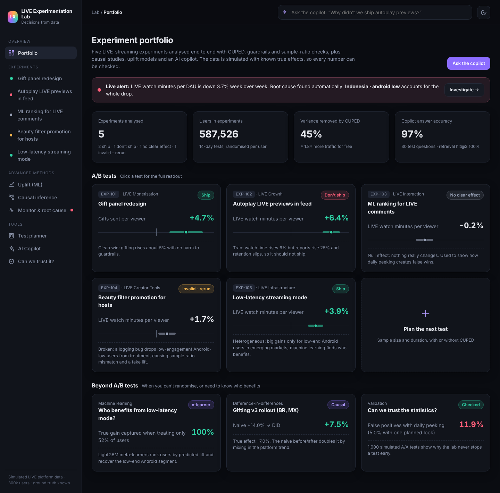
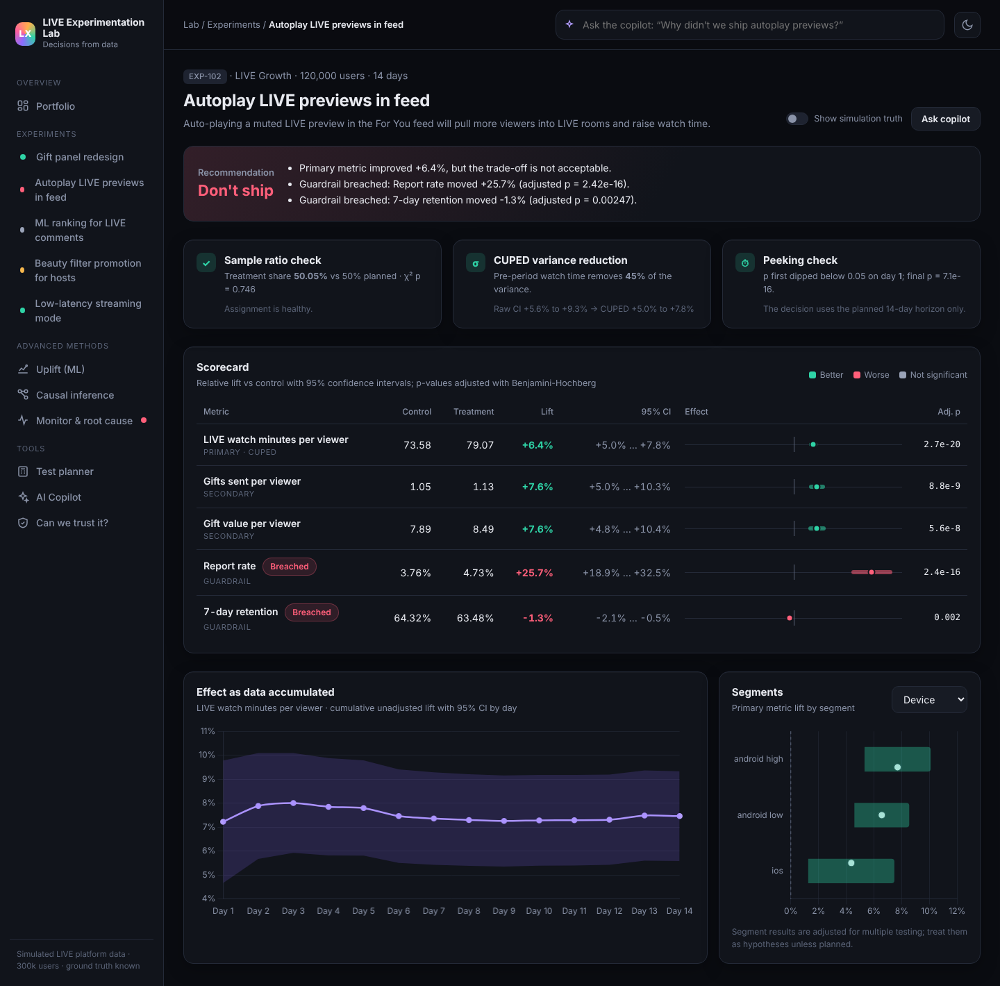
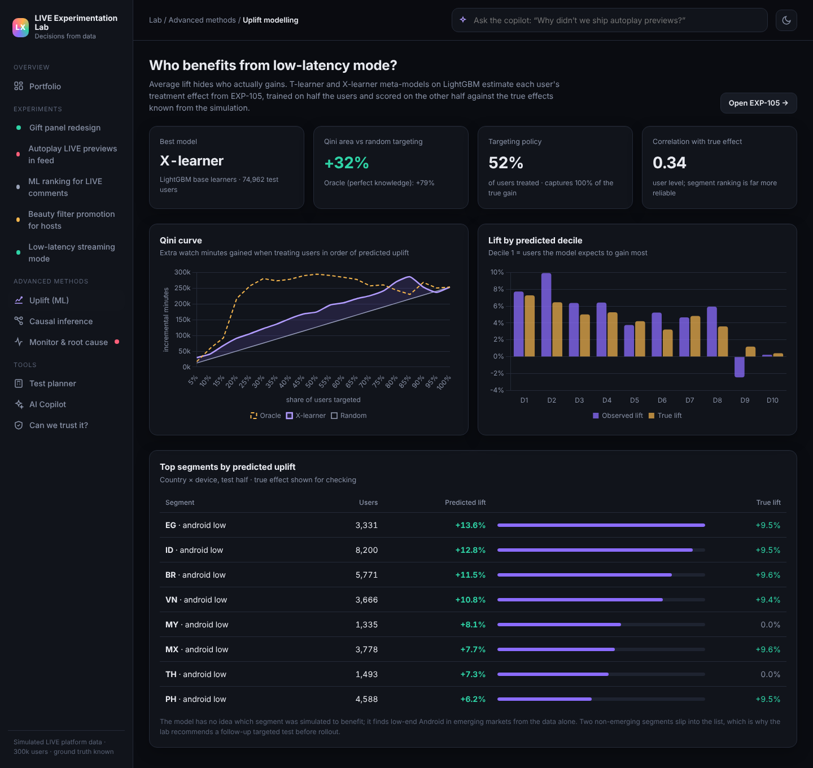
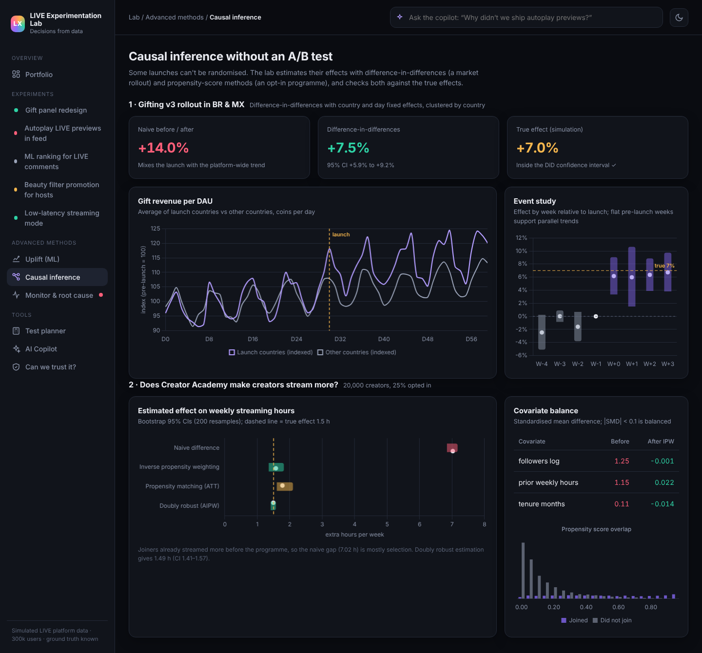
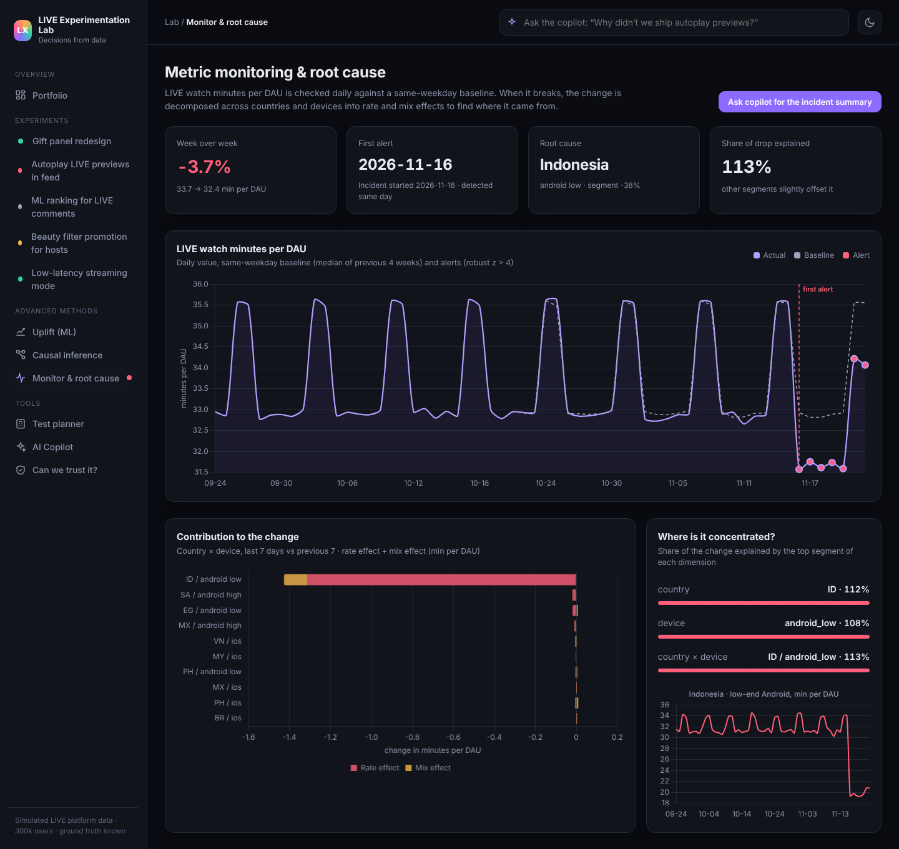
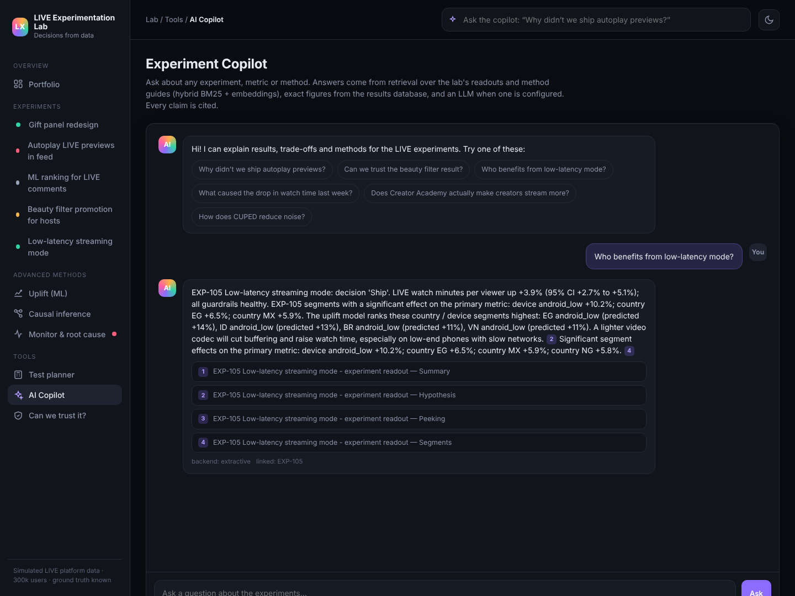
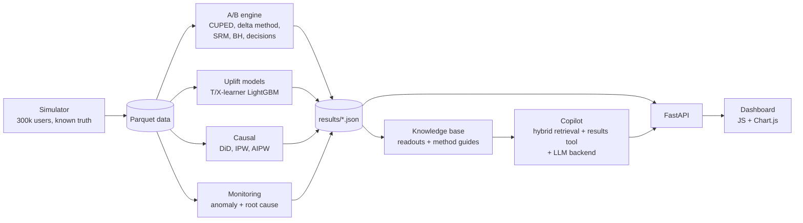

# LIVE Experimentation Lab

**A/B testing, causal inference, machine-learning uplift models and an AI copilot for a LIVE-streaming platform, with a custom web dashboard.**

[](https://github.com/Abakar-Fatime/live-experimentation-lab/actions/workflows/ci.yml)
 



Product teams at LIVE-streaming apps ship dozens of experiments a week. The hard part is not running the t-test. It is knowing **when a result can be trusted, when a win is really a loss, who a feature actually helps, and what to do when you cannot randomise at all.** This project builds that decision layer end to end:

| Layer | What it does |
| --- | --- |
| **A/B test engine** | Welch tests with relative-lift CIs (delta method), **CUPED** variance reduction, ratio metrics, **sample ratio mismatch** checks, guardrails, Benjamini-Hochberg correction, automated ship / don't-ship decisions |
| **Machine learning** | **T-learner and X-learner uplift models (LightGBM)** estimate each user's treatment effect, evaluated with Qini curves against the known truth |
| **Causal inference** | **Difference-in-differences** with an event study for a market rollout; **IPW, propensity matching and doubly robust (AIPW)** estimation for an opt-in programme |
| **Monitoring** | Same-weekday anomaly detection and an automated **root-cause decomposition** (rate vs mix effects) across country and device |
| **AI copilot (RAG)** | Hybrid retrieval (BM25 + LSA embeddings, reciprocal rank fusion), entity linking, a results-database tool for exact numbers, and pluggable **LLM backends** (Ollama, any OpenAI-compatible API, or offline). Every answer is cited |
| **Dashboard** | FastAPI backend and a hand-built single-page app (vanilla JS + Chart.js, dark and light themes): portfolio, experiment readouts, uplift, causal studies, monitoring, test planner, copilot chat and a validation page |

The platform data is **simulated with known true effects** (300,000 users, 5 experiments, 2 causal studies and 1 production incident). That makes something unusual possible: **every estimate in the lab is checked against the truth.**

---

## The five experiments

Each experiment was designed to tell a different story that a real analyst meets:

| Experiment | Story | Lab decision | Primary metric (CUPED) | True effect |
| --- | --- | --- | --- | --- |
| **EXP-101** Gift panel redesign | Clean win | **Ship** | Gifts per viewer **+4.7%** (95% CI +2.1% to +7.4%) | +5.0% |
| **EXP-102** Autoplay LIVE previews | Trap: primary wins, guardrails lose | **Don't ship** | Watch time **+6.4%** (+5.0% to +7.8%), but reports **+25.7%** and 7-day retention **−1.3%** | +6.0% / +25% / −1.5% |
| **EXP-103** ML comment ranking | Null effect | **No clear effect** | Watch time −0.2% (−1.6% to +1.2%) | 0% |
| **EXP-104** Beauty filter promotion | Broken assignment | **Invalid, rerun** | SRM: treatment share 49.15%, p = 1.3e-07. The fake +1.7% lift is a logging bug | 0% |
| **EXP-105** Low-latency mode | Heterogeneous effect | **Ship** (target segment) | Watch time **+3.9%** (+2.7% to +5.1%) | +4.7% on average, +12% for low-end Android in emerging markets |

**Truth check:** in the four experiments that pass the SRM check, **21 of 21 true effects fall inside the 95% confidence intervals.** In the broken EXP-104, the sample ratio mismatch biases watch time upward. The lab catches this and refuses to make a decision.



## Measured results

### CUPED variance reduction
Using pre-period watch time as the covariate removes **44–46% of the variance** in every experiment, so the intervals are about 25% narrower. In EXP-102, the unadjusted estimate is +7.5% (CI +5.6% to +9.3%). CUPED gives +6.4% (CI +5.0% to +7.8%), closer to the true +6.0%.

### Can the statistics be trusted? (Monte-Carlo validation)
| Check | Result |
| --- | --- |
| A/A tests, one look at day 14 (1,000 simulations) | **5.0%** false positives (target 5%) |
| A/A tests, stop at first daily p < 0.05 ("peeking") | **11.9%** false positives: more than double |
| 95% CI coverage, raw / CUPED (1,000 simulations) | **94.1% / 93.4%**, with CUPED intervals 30% narrower |
| Power promised by the sample-size formula / delivered | **80% / 79.4%** (500 simulations) |

### Machine learning: who benefits? (EXP-105)
| Model | Qini area vs random targeting | Correlation with true effect |
| --- | --- | --- |
| T-learner (LightGBM) | +31% | 0.30 |
| **X-learner (LightGBM)** | **+32%** | **0.34** |
| Oracle (knows the truth) | +79% | 1.00 |

The top four segments the model finds are **Egypt, Indonesia, Brazil and Vietnam on low-end Android**, exactly the simulated beneficiaries. Treating only segments with a predicted lift above 4% reaches **52% of users and captures 100% of the true gain**. Segment precision is 67%, so the lab recommends a targeted follow-up test.



### Causal inference without randomisation
| Study | Naive estimate | Method | Estimate (95% CI) | Truth |
| --- | --- | --- | --- | --- |
| Gifting v3 rollout in Brazil and Mexico | +14.0% (before/after) | Difference-in-differences, country + day fixed effects | **+7.5%** (+5.9% to +9.2%) | +7.0% |
| Creator Academy (opt-in) | +7.02 h/week | Inverse propensity weighting | +1.57 h (1.35 to 1.82) | +1.5 h |
| | | Doubly robust (AIPW) | **+1.49 h** (1.41 to 1.57) | |
| | | 1:1 propensity matching | +1.77 h (1.60 to 2.10) | |

The event study shows flat pre-launch weeks, which supports parallel trends. Weighting brings covariate imbalance from standardised mean differences above 1.1 down to below 0.03. Matching is shown honestly: it misses the truth here, which is why the lab reports a doubly robust estimate.



### Monitoring and root cause
A bug in the Android v8.3 video player cut watch time in one segment. The detector raises its first alert **on 16 November, the day the incident starts**, with no false alarms before the incident. The rate/mix decomposition attributes the whole week-over-week drop (−3.7%) to **Indonesia × low-end Android**, where minutes per DAU fell 38%.



### AI copilot (RAG) evaluation
The copilot was evaluated on 30 hand-written questions about the experiments, metrics and methods, using the offline backend:

| Retriever | hit@1 | hit@3 | MRR |
| --- | --- | --- | --- |
| BM25 (keywords) | 80.0% | 96.7% | 0.89 |
| LSA embeddings | 86.7% | 96.7% | 0.92 |
| **Hybrid (reciprocal rank fusion + entity linking)** | **93.3%** | **100%** | **0.97** |

Answers contain the expected key fact in **97% (29/30)** of questions, and out-of-scope questions ("What is the capital of France?") are declined. The evaluation set is small and was written alongside the knowledge base, so it shows the system works rather than how it would score on outside questions.



---

## Architecture



## Quick start

```bash
git clone https://github.com/Abakar-Fatime/live-experimentation-lab.git
cd live-experimentation-lab
pip install -r requirements.txt

python -m lab.pipeline              # simulate, analyse, validate, build the knowledge base (~30 s)
uvicorn lab.api:app --port 8000     # dashboard at http://localhost:8000
pytest -q                           # 23 tests
```

The dashboard also works as a static site: the pipeline copies every result into `web/data/`, so all pages except the copilot can be served from GitHub Pages or any static host.

### Connecting an LLM
The copilot works offline by default. It retrieves, cites and composes answers from the retrieved passages. To have an LLM write the answer from the same cited context:

```bash
# Local and free, with Ollama
ollama pull qwen2.5:3b-instruct
LAB_LLM_BACKEND=ollama uvicorn lab.api:app

# Any OpenAI-compatible API (OpenAI, Groq, Together, ...)
LAB_LLM_BACKEND=openai OPENAI_BASE_URL=https://api.groq.com/openai/v1 OPENAI_API_KEY=... \
LAB_LLM_MODEL=llama-3.1-8b-instant uvicorn lab.api:app
```

If the LLM is unreachable, the copilot falls back to the offline answerer instead of failing.

## Project structure

```
lab/
  simulate.py        LIVE platform simulator with known true effects
  stats.py           Welch / delta method / CUPED / SRM / power / Benjamini-Hochberg
  experiments.py     experiment readouts, segments, cumulative effects, decisions
  uplift.py          T-learner and X-learner (LightGBM), Qini evaluation
  causal.py          difference-in-differences, event study, IPW, matching, AIPW
  monitor.py         anomaly detection and rate/mix root-cause decomposition
  validate.py        Monte-Carlo checks: A/A, peeking, coverage, power
  copilot/           knowledge base, hybrid retriever, LLM backends, evaluation
  api.py             FastAPI backend
  pipeline.py        runs everything end to end
knowledge/           method guides + generated readouts the copilot retrieves from
results/             every analysis output (JSON)
web/                 dashboard (index.html, app.js, styles.css)
tests/               23 tests: statistics, analyses vs truth, copilot, API
```

## Notes
- All data is synthetic and generated by `lab/simulate.py` with a fixed seed, so every number in this README can be reproduced with `python -m lab.pipeline`.
- The decision rules (SRM → invalid; guardrail breach → don't ship; significant primary win → ship) follow common industry practice. Real teams add business context, such as costs and long-term effects.

---
Built by **Abakar Sougui Fatime**: [GitHub](https://github.com/Abakar-Fatime) · [LinkedIn](https://linkedin.com/in/abakar-sougui-fatime)
